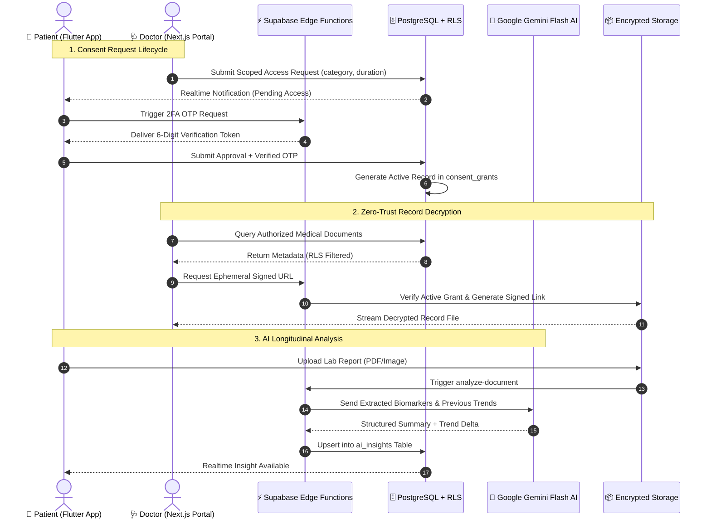
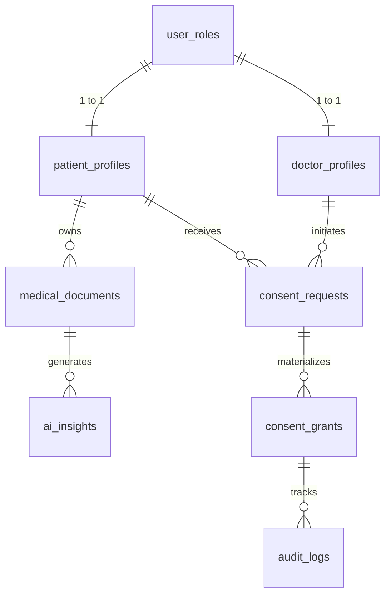

# MediLocker Technical Architecture & Engineering Design

## 1. System Context & Data Flow

---

## 2. Entity-Relationship Model (PostgreSQL)

---

## 3. Engineering Quality Metrics

- **Modularity:** Separation of concerns across `Client UI`, `State Providers`, `Data Models`, `Edge Compute`, and `Database Policies`.
- **Database Indexing:** Indexed on `(user_id, category)`, `(doctor_id, status)`, `(patient_id, expires_at)`.
- **Zero-Trust Hardening:** Client applications possess no service role tokens; all authorization decisions resolve inside PostgreSQL Row-Level Security policies.
